<div align="center">

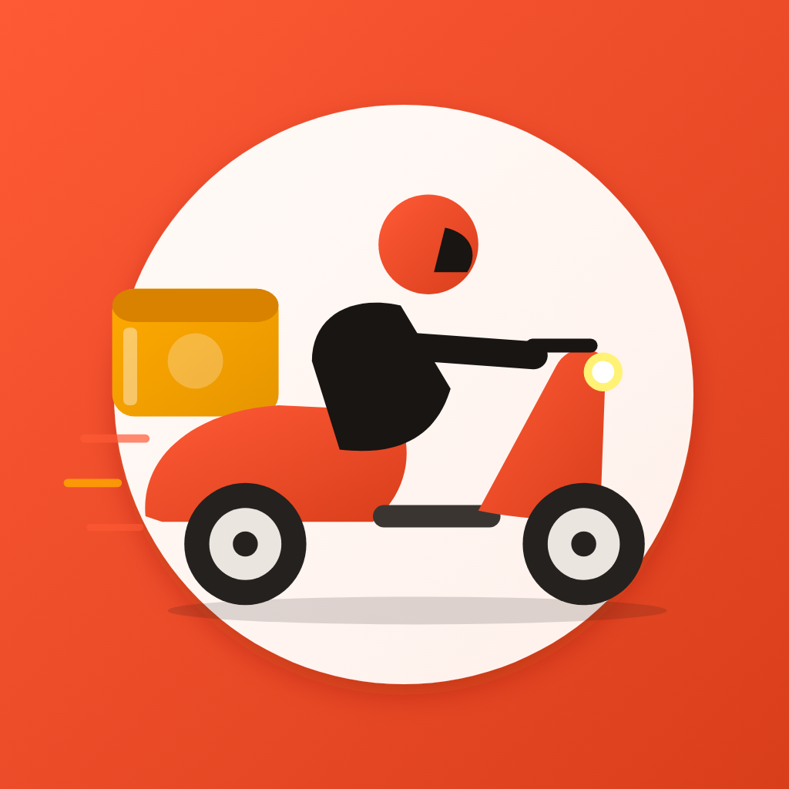

# Biteful: React Native Food Delivery App

**Good food, craved and delivered fast.**

A food delivery mobile app for **iOS, Android, and Web**, built with **React Native**, **Expo SDK**, **NativeWind v4 (Tailwind CSS)**, **Phosphor Icons**, and **Zustand**.

<br />

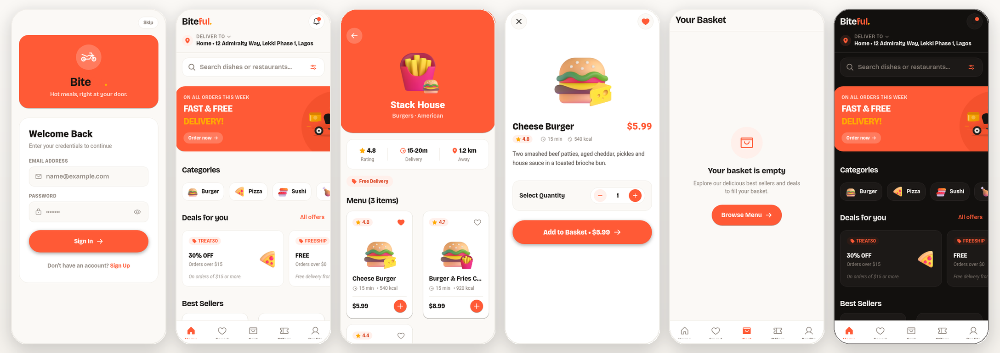

</div>

<br />

---

## Tech Stack

* **Framework**: React Native with [Expo SDK](https://expo.dev) (New Architecture enabled)
* **Routing**: [Expo Router](https://docs.expo.dev/router/introduction/) (File-based navigation)
* **Styling**: [NativeWind v4](https://www.nativewind.dev) (Tailwind CSS)
* **Icons**: [Phosphor Icons](https://github.com/duongdev/phosphor-react-native) (`phosphor-react-native`) with dynamic weights
* **State Management**: [Zustand](https://github.com/pmndrs/zustand)
* **Image Delivery**: `expo-image`
* **Haptics**: `expo-haptics`
* **Fonts**: Bricolage Grotesque

---

## Color Palette (Electric Tangerine & Warm Honey)

* **Primary**: `#FF5A36` (Electric Tangerine)
* **Deep**: `#D93E1B` (Deep Tangerine)
* **Secondary / Badges**: `#FFAA00` (Warm Golden Amber)
* **Surface / Cards**: `#FFFFFF` (Light) / `#1C1917` (Dark)
* **Background / Paper**: `#FBF9F6` (Linen Cream) / `#12100E` (Obsidian)
* **Ink (Text)**: `#181512` (Espresso Charcoal)
* **Wash**: `#FFF0EB` (Tangerine tint for pills, badges and steppers)

---

## Screens

<table>
  <tr>
    <td align="center">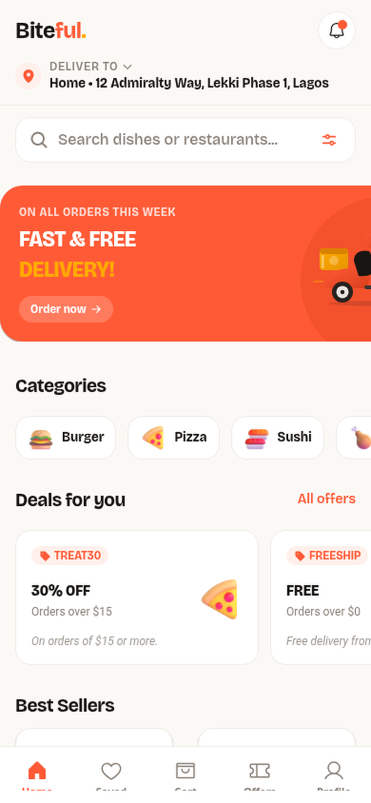<br /><sub><b>Home Screen</b></sub></td>
    <td align="center">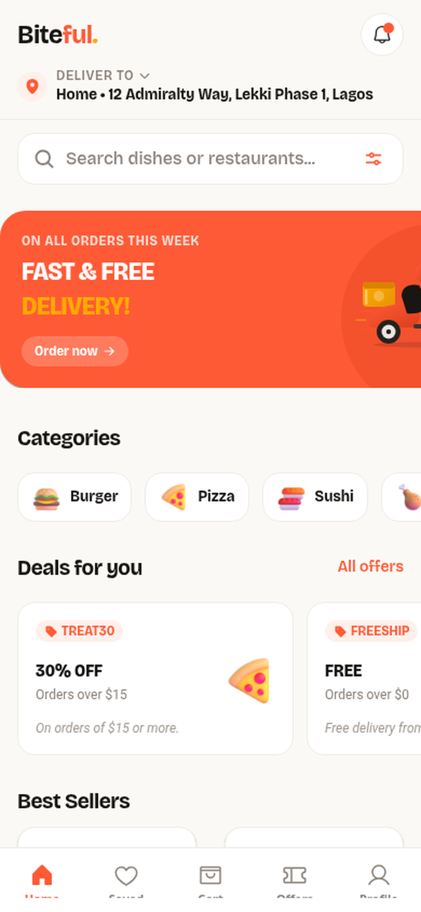<br /><sub><b>Deals & Categories</b></sub></td>
    <td align="center">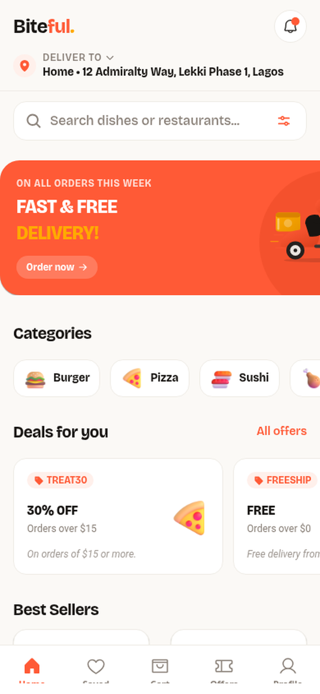<br /><sub><b>Best Sellers Grid</b></sub></td>
    <td align="center">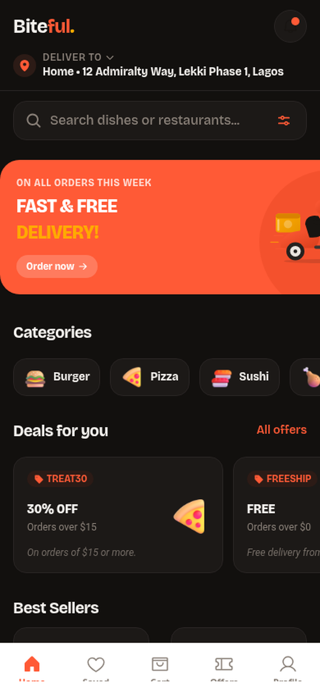<br /><sub><b>Dark Mode</b></sub></td>
  </tr>
  <tr>
    <td align="center">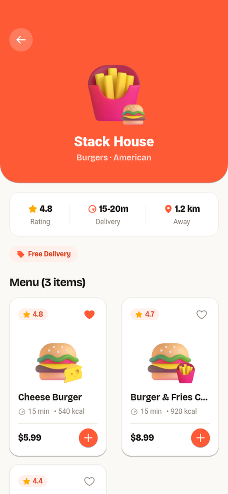<br /><sub><b>Restaurant & Menu</b></sub></td>
    <td align="center">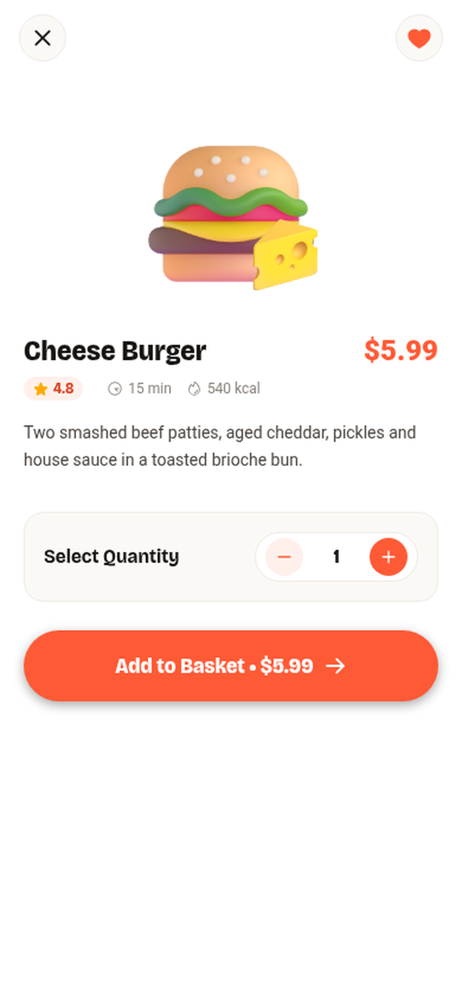<br /><sub><b>Dish Detail Sheet</b></sub></td>
    <td align="center">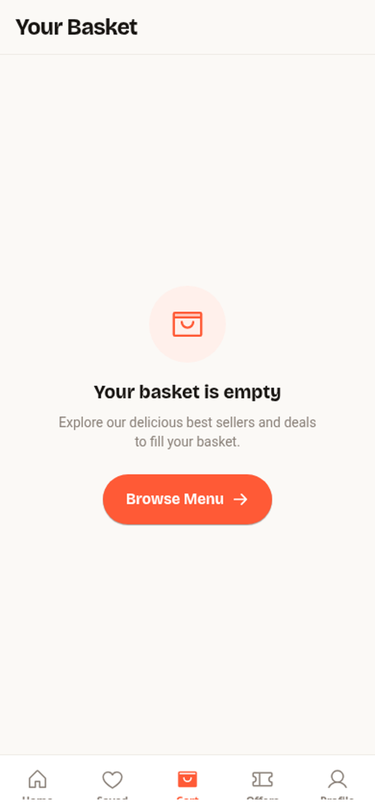<br /><sub><b>Cart & Checkout</b></sub></td>
    <td align="center">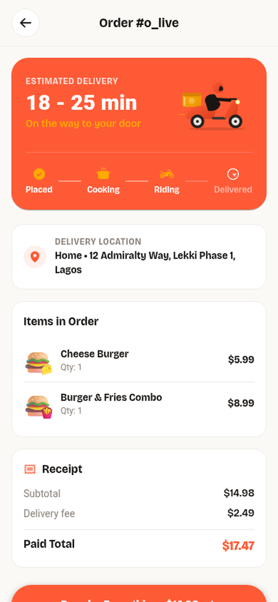<br /><sub><b>Live Order Tracking</b></sub></td>
  </tr>
  <tr>
    <td align="center">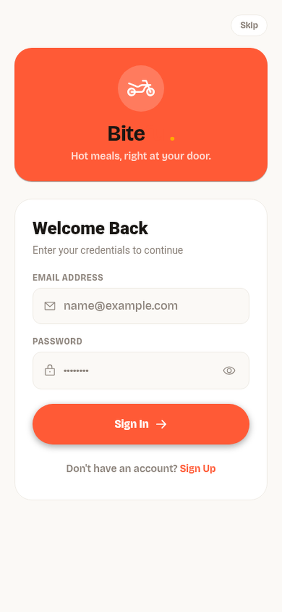<br /><sub><b>Sign In & Auth</b></sub></td>
    <td align="center">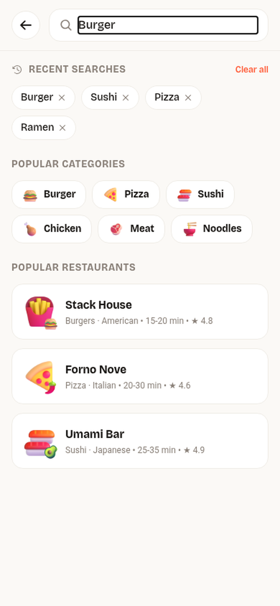<br /><sub><b>Live Search & Filter</b></sub></td>
    <td align="center">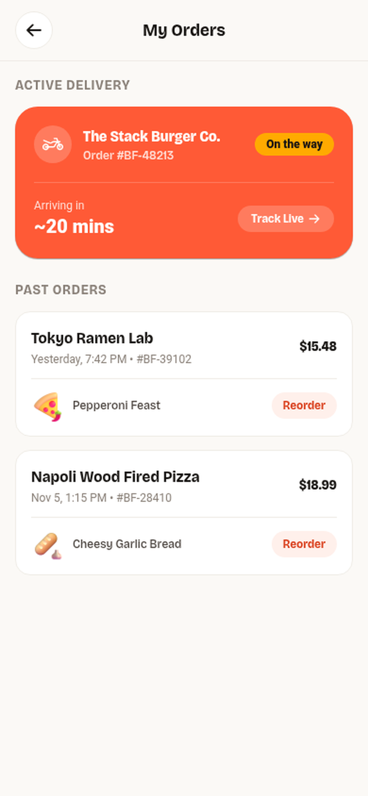<br /><sub><b>Order History</b></sub></td>
    <td align="center">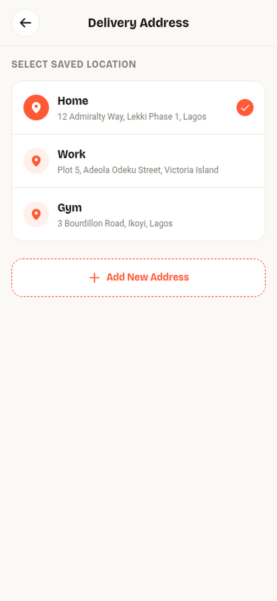<br /><sub><b>Delivery Addresses</b></sub></td>
  </tr>
</table>

---

## Project Structure

```
├── app/                  # Expo Router file-based screens and layouts
│   ├── _layout.tsx       # Root layout with Tailwind CSS and font loader
│   ├── (tabs)/           # 5 Bottom tabs: Home, Saved, Cart, Offers, Profile
│   ├── (auth)/           # Sign-in & Sign-up screens
│   ├── dish/[id].tsx     # Dish detail sheet modal
│   ├── restaurant/[id].tsx # Restaurant profile and menu
│   ├── order/[id].tsx    # Live order tracking and timeline
│   ├── search.tsx        # Search screen with live filtering
│   ├── addresses.tsx     # Delivery address selector
│   ├── notifications.tsx # Notification center
│   └── orders.tsx        # Order history
├── components/           # Reusable UI primitives and section components
│   ├── common/           # Wordmark, FoodCard, FoodArtView, QtyStepper, AnimatedRider
│   └── home/             # HomeHeader, CategoryStrip, PromoCarousel, DealsStrip
├── stores/               # Zustand state stores (Cart, Catalog, Saved, Session)
├── types/                # Domain TypeScript interfaces (Catalog, Order, Account)
├── utils/                # Money formatting (integer cents) and food asset map
├── assets/
│   ├── brand/            # Brand icons (icon.png, adaptive-icon.png, favicon.png)
│   ├── data/             # Standalone JSON seed catalogs
│   ├── fonts/            # Bricolage Grotesque typeface cuts
│   └── images/food/      # 3D food artwork
├── docs/
│   ├── hero.png          # App hero montage banner
│   └── screens/          # App screenshots
├── global.css            # Tailwind directives
├── tailwind.config.js    # Biteful theme tokens
└── app.json              # Expo configuration
```

---

## Getting Started

```bash
# Start development server
npx expo start

# Open on platforms
# Press 'a' for Android emulator
# Press 'i' for iOS simulator
# Press 'w' for Web browser
```
